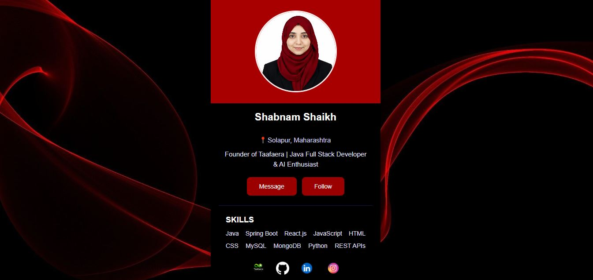

# HTML5-PROJECTS
A simple, elegant, and responsive personal projects  built using **HTML and Inline CSS**. This project showcases my professional profile, technical skills, profile picture, and social media links in a modern black-and-red theme with a neon glow effect.

## WELCOME

### 1. Personal Profile Card

https://profilecard-neon.vercel.app/

## Profile Card

A responsive personal portfolio card built using HTML5 and inline CSS. Features a modern black-and-red theme, neon glowing profile picture, technical skills, and clickable GitHub, LinkedIn, and email links. Designed to showcase my professional profile in a simple and stylish layout.
